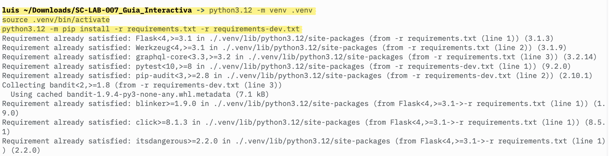
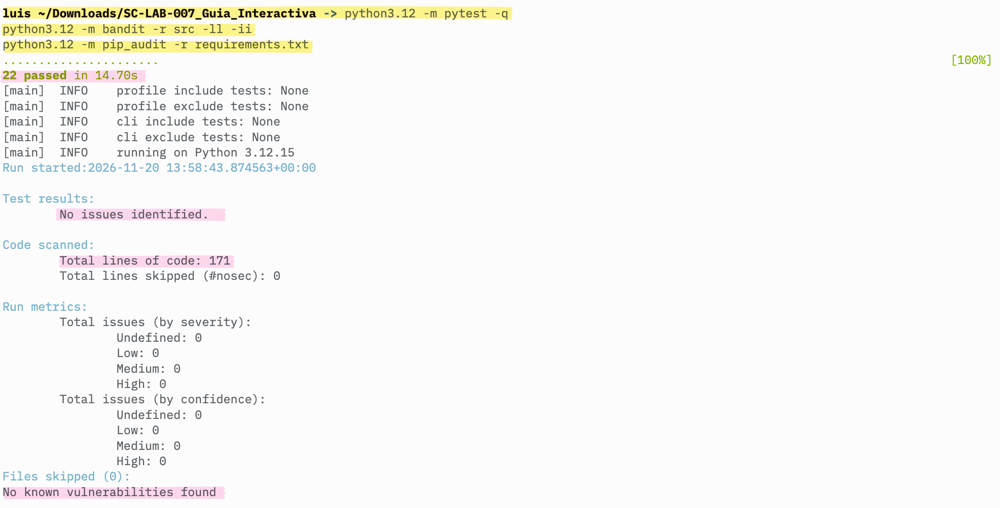
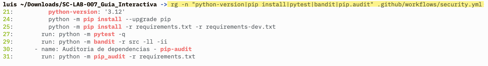

# Reporte de Verificación de Seguridad y Paridad con CI — SC-LAB-009

**Practica:** `SC-LAB-009`  
**Fecha de ejecución:** 20 de noviembre de 2026
**Entorno local:** Python `3.12.15` (entorno virtual `.venv`, macOS ARM64)  
**Pipeline auditado:** `.github/workflows/security.yml`

---

## 1. Objetivo

Ejecutar localmente los controles automatizados de pruebas unitarias, análisis estático de código (SAST) y auditoría de dependencias (SCA), verificar su correspondencia exacta con el flujo de integración continua definido en `.github/workflows/security.yml` y documentar la evidencia real obtenida sin omitir ni suavizar controles.

---

## 2. Preparación del Entorno y Dependencias

Se creó y activó un entorno virtual aislado con Python 3.12 para instalar tanto las dependencias de producción (`requirements.txt`) como las herramientas de desarrollo y seguridad (`requirements-dev.txt`):



### Paquetes principales verificados

| Archivo | Paquete | Restricción | Versión instalada |
| :--- | :--- | :--- | :--- |
| `requirements.txt` | `Flask` | `<4,>=3.1` | `3.1.3` |
| `requirements.txt` | `Werkzeug` | `<4,>=3.1` | `3.1.9` |
| `requirements.txt` | `graphql-core` | `<3.3,>=3.2` | `3.2.14` |
| `requirements-dev.txt` | `pytest` | `<10,>=8` | `9.2.0` |
| `requirements-dev.txt` | `pip-audit` | `<3,>=2.8` | `2.10.1` |
| `requirements-dev.txt` | `bandit` | `<2,>=1.8` | `1.9.4` |

---

## 3. Resumen Ejecutivo de Resultados

| Control | Tipo | Comando ejecutado | Resultado | Hallazgos |
| :--- | :--- | :--- | :--- | :--- |
| **Pruebas unitarias** | Funcional / Regresión | `python3.12 -m pytest -q` | Aprobado | `22 passed in 14.70s` |
| **Bandit** | SAST (`src`) | `python3.12 -m bandit -r src -ll -ii` | Aprobado | `0` alertas (`171` líneas analizadas, `0` `#nosec`) |
| **pip-audit** | SCA (`requirements.txt`) | `python3.12 -m pip_audit -r requirements.txt` | Aprobado | `0` vulnerabilidades conocidas |

---

## 4. Evidencia de Ejecución Local

### 4.1 Pruebas unitarias (`pytest`)



```bash
python3.12 -m pytest -q
......................                                       [100%]
22 passed in 14.70s
```

* **Interpretación:** La suite completa de 22 pruebas finalizó sin fallos ni omisiones.

### 4.2 Análisis estático de seguridad (`bandit`)

```bash
python3.12 -m bandit -r src -ll -ii
[main]	INFO	running on Python 3.12.15
Run started:2026-11-20 13:58:43.874563+00:00

Test results:
	No issues identified.

Code scanned:
	Total lines of code: 171
	Total lines skipped (#nosec): 0

Run metrics:
	Total issues (by severity):
		Undefined: 0 | Low: 0 | Medium: 0 | High: 0
	Total issues (by confidence):
		Undefined: 0 | Low: 0 | Medium: 0 | High: 0
Files skipped (0):
```

* **Interpretación:** Se escanearon 171 líneas bajo `src` con filtro de severidad media/alta (`-ll`) y confianza media/alta (`-ii`). No se detectaron problemas en ninguna categoría, no se omitió ningún archivo y no se utilizaron directivas `#nosec` para suprimir advertencias.

### 4.3 Auditoría de dependencias (`pip-audit`)

```bash
python3.12 -m pip_audit -r requirements.txt
No known vulnerabilities found
```

* **Interpretación:** Ninguna de las dependencias declaradas en `requirements.txt` (ni sus dependencias transitivas resueltas en el entorno) presenta vulnerabilidades conocidas registradas al momento de la consulta.

---

## 5. Verificación de Paridad con `.github/workflows/security.yml`

Se inspeccionó el archivo `.github/workflows/security.yml` para confirmar que el pipeline ejecuta exactamente los mismos controles y parámetros que la validación local:



### Matriz de correspondencia Local vs. CI

| Etapa | Ejecución local | Definición en `security.yml` | Línea(s) | Estado de paridad |
| :--- | :--- | :--- | :--- | :--- |
| Versión de Python | `python3.12` (`3.12.15`) | `python-version: '3.12'` | 21 | Coincide |
| Actualización de `pip` | `pip 26.2.1` (sin actualizar) | `python -m pip install --upgrade pip` | 24 | Diferencia menor |
| Instalación de paquetes | `python3.12 -m pip install -r requirements.txt -r requirements-dev.txt` | `python -m pip install -r requirements.txt -r requirements-dev.txt` | 25 | Coincide |
| Pruebas unitarias | `python3.12 -m pytest -q` | `run: python -m pytest -q` | 27 | Coincide |
| Análisis estático (SAST) | `python3.12 -m bandit -r src -ll -ii` | `run: python -m bandit -r src -ll -ii` | 29 | Coincide |
| Auditoría SCA | `python3.12 -m pip_audit -r requirements.txt` | `run: python -m pip_audit -r requirements.txt` | 30–31 | Coincide |

---

## 6. Integridad de los Controles y Observaciones

* **Cero evasión de controles:** Todos los comandos se ejecutaron con sus banderas originales y sin modificaciones orientadas a forzar un estado aprobatorio. La métrica `Total lines skipped (#nosec): 0` y `Files skipped (0)` en Bandit confirma que no se ocultaron alertas en el código fuente.
* **Diferencia menor registrada:** El pipeline actualiza `pip` en la línea 24 antes de instalar dependencias, mientras que en el entorno local se empleó `pip 26.2.1`. Esta variación no afectó la resolución de versiones ni el resultado de las herramientas de seguridad.
* **Estado general:** Los tres controles de calidad y seguridad definidos aprobaron con paridad verificada respecto al workflow `.github/workflows/security.yml`.